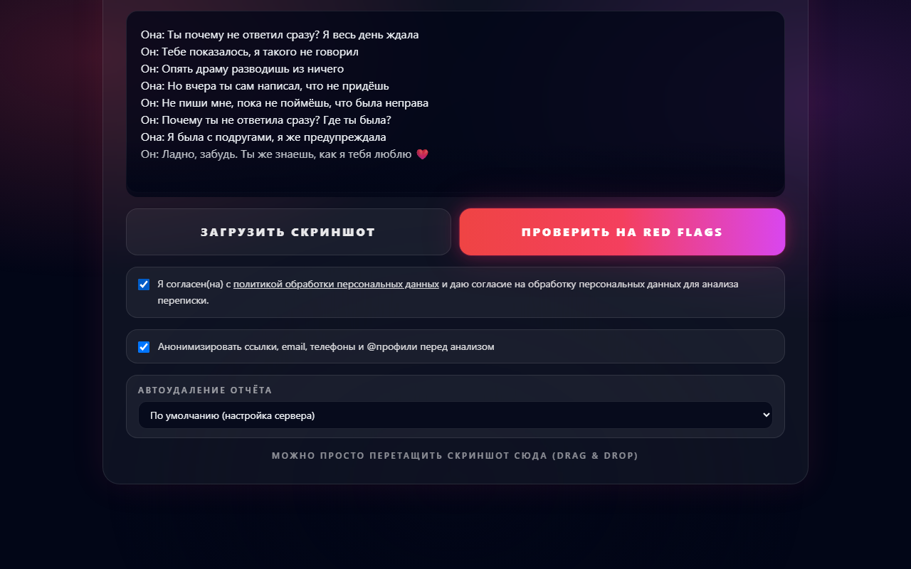
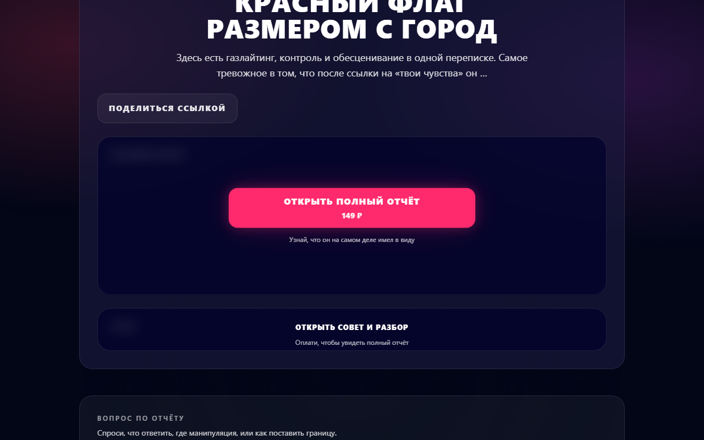
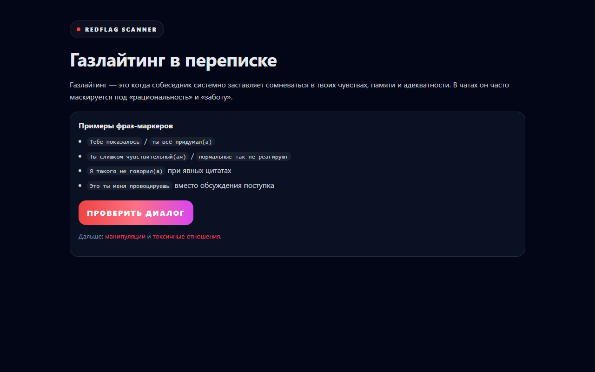

# RedFlag Scanner

**English** · [Русский](README.ru.md)

**A web app that reads a chat conversation and flags toxic patterns: gaslighting, control, devaluation, silent treatment, blackmail. It returns a 0–100 risk score, a verdict, the flagged quotes and what to reply.**
Powered by YandexGPT, with Telegram login, a paid full report, shareable links and PDF export.

> **Portfolio project, built AI-first, and now closed.** The live service (toxiscan.ru) no longer exists, so run it locally (steps below).
> An honest review of strengths and weaknesses: [docs/AUDIT.md](docs/AUDIT.md). The UI and the AI prompts are in Russian.


## Screenshots

| Home | Paste a chat |
|---|---|
|  |  |

| Result: score, verdict, red flags | Paywall on the full report |
|---|---|
|  |  |

| SEO landing page | Mobile |
|---|---|
|  |  |

## What it does

- **AI analysis of a conversation.** Risk rating 0–100, short verdict, teaser, full breakdown, advice and a list of flags with quotes and suggested replies.
- **Screenshot input.** Server-side OCR (Tesseract, Russian and English) turns a chat screenshot into text, and a Telegram export parser normalizes pasted text.
- **Follow-up questions** on an existing scan (Q&A over the result).
- **Paid full report (149 RUB).** The free view is redacted **on the server**; payment through YooKassa or Robokassa with an idempotent webhook table.
- **Sharing.** Public report link `/r/<token>`, Open Graph images (SVG and PNG) rendered on the server, PDF export with a custom font.
- **Privacy controls.** Explicit consent, optional anonymization of links, emails, phones and @handles before text reaches the AI, per-report auto-delete (TTL).
- **Auth.** Telegram login, HTTP-only session cookies, double-submit CSRF plus Origin checks, rate limiting.
- **SEO.** 16 static landing pages for individual manipulation patterns, sitemap, robots and dynamic meta tags.
- **Resilience for the LLM calls.** Retries, circuit breaker, concurrency limit.

## Tech stack

| Layer | Technology |
|---|---|
| Client | React 18, TypeScript, Vite, Tailwind CSS, SSR prerendering for landing pages |
| Server | Node.js, Express 5, Prisma 6, PostgreSQL 17 |
| AI | YandexGPT (REST) |
| OCR and files | Tesseract, pdfkit, resvg (SVG to PNG) |
| Payments | YooKassa, Robokassa |
| Infra | Docker Compose, nginx, Let's Encrypt |

```
client/   React SPA, SEO landing pages, prerender script
server/   Express API (src/index.js), YandexGPT service, Prisma schema and migrations
nginx/    Edge reverse-proxy configs
docs/     Audit and media
```

## Run it locally

Requirements: Docker. You need your own YandexGPT credentials for real analyses.

```bash
cp .env.example .env
# fill at least: SESSION_SECRET (32+ chars), YANDEX_FOLDER_ID, YANDEX_API_KEY
docker compose up -d --build
docker compose exec -T server wget -qO- http://localhost:5000/api/health
```

Build the frontend (served by the `edge` nginx profile):

```bash
cd client && npm ci && npm run build
cd .. && docker compose --profile edge up -d
```

Payments need YooKassa or Robokassa credentials, and in production the payment webhook **must** be protected with `PAYMENT_WEBHOOK_TOKEN` and/or `PAYMENT_WEBHOOK_ALLOWED_CIDRS` (the server rejects it otherwise).

To try the UI without a YandexGPT key, point `YANDEX_GPT_API_URL` at any server that returns the YandexGPT response shape. That is how the screenshots here were produced.

The full variable reference, API list and deploy notes are in [README.ru.md](README.ru.md) and [DEPLOY.md](DEPLOY.md) (Russian).

## Known limitations

This is a closed pet project. Read [docs/AUDIT.md](docs/AUDIT.md) before reusing anything: the whole API is one 5,400-line file, there are no automated tests, and the payment webhook does not re-verify payments with the YooKassa API.

## Privacy note

Legal pages (`offer.html`, `privacy.html`) contain placeholders instead of the original operator's name, tax ID and email. Replace them before running a real service.

## License

[MIT](LICENSE)
