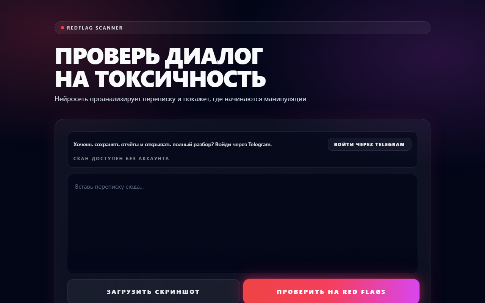
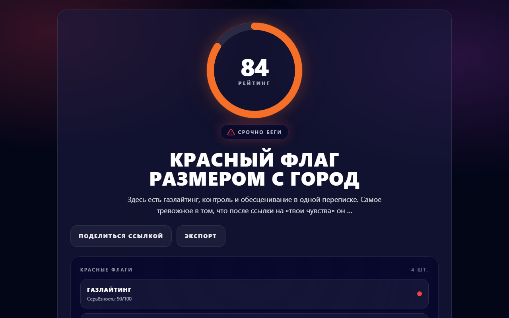
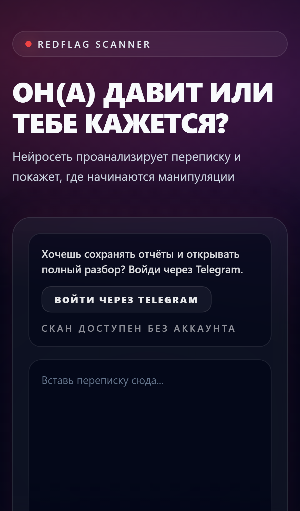

# RedFlag Scanner

[English](README.md) · **Русский**

RedFlag Scanner — веб‑приложение для анализа переписок с помощью YandexGPT: выявляет токсичные паттерны и «красные флаги», показывает рейтинг риска, формирует развёрнутый разбор, генерирует превью для шаринга и PDF‑отчёт.

> **Pet-проект для портфолио, разработан AI-first подходом. Проект закрыт**, живой версии (toxiscan.ru) больше нет. Запускается локально, см. ниже. Разбор сильных и слабых сторон: [docs/AUDIT.md](docs/AUDIT.md).


| Главная | Результат | Мобильная версия |
|---|---|---|
|  |  |  |

Продукт: пользователь вставляет переписку (или загружает скриншот, текст распознаётся Tesseract), нейросеть возвращает рейтинг токсичности 0–100, список красных флагов с цитатами и советы. Полный отчёт открывался за 149 ₽ через ЮKassa/Robokassa.

## Что умеет

- AI‑анализ переписки: рейтинг 0–100, краткий вердикт, разбор, совет, список флагов с цитатами.
- Уточняющие вопросы к уже сделанному скану (Q&A поверх результата).
- История сканов/анализов в базе, удаление по запросу.
- Публичная ссылка на отчёт (`/r/<shareId>`) и публичный JSON/PDF для шаринга.
- OG‑картинка для ссылок (SVG/PNG).
- Экспорт отчёта в PDF.
- Оплата разблокировки полного отчёта через ЮKassa, обработка webhook с идемпотентностью.
- Настройки приватности: согласие на обработку, авто‑удаление по TTL, анонимизация текста перед отправкой в AI.

## Архитектура

Сервисы и роли:

- **server** — Node.js + Express, API, интеграции YandexGPT/ЮKassa, генерация OG/PDF, Prisma.
- **db** — PostgreSQL.
- **nginx (edge, опционально)** — reverse proxy и раздача фронта в прод‑схеме (HTTPS + домен).

База данных управляется Prisma migrations (автоприменение при старте server, если не отключено переменной окружения).

## Быстрый старт (локально)

Политика проекта: выполнение приложения — только в Docker. На хосте используем команды только для сборки/линта/тайпчека.

### 1) Подготовить `.env`

В корне проекта (рядом с `docker-compose.yml`):

```bash
cp .env.example .env
```

Заполни минимум:

```env
# PostgreSQL
POSTGRES_USER=postgres
POSTGRES_PASSWORD=postgres
POSTGRES_DB=redflag_scanner

# Backend
PORT=5000
SESSION_SECRET=replace_me_with_32+_chars_secret

# YandexGPT
YANDEX_FOLDER_ID=
YANDEX_API_KEY=

# ЮKassa
YOOKASSA_SHOP_ID=
YOOKASSA_SECRET_KEY=
YOOKASSA_RETURN_URL=http://localhost/

# Webhook защита (обязателен хотя бы один барьер)
PAYMENT_WEBHOOK_TOKEN=
PAYMENT_WEBHOOK_ALLOWED_CIDRS=
```

### 2) Поднять API и базу

```bash
docker compose up -d --build
docker compose ps
```

Проверка здоровья API:

```bash
docker compose exec -T server wget -qO- http://localhost:5000/api/health
```

Ожидаемый ответ:

```json
{"ok":true}
```

### 3) Фронтенд

В репозитории есть сборка фронта (Vite → `client/dist`) и nginx‑конфиги, но **edge‑nginx** рассчитан на прод‑домен и TLS‑сертификаты.

- Для прод‑схемы с доменом и HTTPS используй профиль `edge`:

```bash
docker compose --profile edge up -d --build
```

Требование: в контейнер `nginx` должны быть проброшены реальные сертификаты Let’s Encrypt, а `client/dist` должен существовать (собран заранее).

Подробный сценарий деплоя: [DEPLOY.md](./DEPLOY.md)

## API

База: все запросы идут на тот же origin, что и фронт. Для cookie‑авторизации клиент отправляет `withCredentials=true`.

### Auth и CSRF

- `GET /api/auth/me` → текущий пользователь или `null`.
- `GET /api/auth/csrf` → выдаёт CSRF токен и кладёт cookie `csrf`.
- `POST /api/auth/register` (CSRF) → регистрация, устанавливает `sid` (HTTP‑only cookie) и обновляет CSRF.
- `POST /api/auth/login` (CSRF) → логин, устанавливает `sid` и обновляет CSRF.
- `POST /api/auth/logout` (CSRF) → логаут, удаляет `sid` и обновляет CSRF.

CSRF защита: двойная отправка cookie + заголовок `X-CSRF-Token`, плюс проверка Origin/Referer на соответствие разрешённым origin.

### Сканирование и анализ

- `POST /api/scan` (auth + CSRF) → создать скан переписки.
- `GET /api/scan/:id` (auth) → получить свой скан.
- `DELETE /api/scan/:id` (auth + CSRF) → удалить свой скан.
- `POST /api/scan/:id/ask` (auth + CSRF) → задать вопрос по результату.

- `POST /api/analyze` (auth + CSRF) → создать анализ (схож с `scan`, используется отдельная сущность).
- `DELETE /api/analysis/:id` (auth + CSRF) → удалить свой анализ.

### Публичный доступ и файлы

- `GET /r/:token` → HTML‑лендинг для шаринга отчёта.
- `GET /api/scan/public/:token` → публичный JSON (для не оплаченного контент редактируется).
- `GET /api/scan/public/:token.pdf` → публичный PDF.
- `GET /api/og/scan/:token.svg` → OG превью (SVG).
- `GET /api/og/scan/:token.png` → OG превью (PNG).

### Оплата (ЮKassa)

- `POST /api/pay` (auth + CSRF) → создать оплату для скана или анализа.
- `POST /api/payment/create` (auth + CSRF) → альтернативный endpoint создания оплаты (для analysis).
- `POST /api/payment/webhook` → webhook ЮKassa.
- `POST /api/payment/webhook/:token` → webhook с токеном в URL.

Webhook:

- Верифицируется токеном и/или белым списком CIDR.
- Идемпотентность: события фиксируются в таблице `payment_webhook_events` (Prisma модель `PaymentWebhookEvent`).

### Служебные

- `GET /api/health` → проверка доступности API и БД.

## Переменные окружения (основные)

Переменные задаются в `.env` в корне проекта и подхватываются `docker-compose.yml`.

### PostgreSQL

- `POSTGRES_USER`, `POSTGRES_PASSWORD`, `POSTGRES_DB`

### Backend (server)

- `PORT` — порт API внутри контейнера.
- `SESSION_SECRET` — секрет для хеширования токенов сессии (минимум 32 символа).
- `CORS_ORIGIN` — список origin через запятую (если пусто, CORS разрешает любой origin).
- `COOKIE_SECURE` — принудительно ставить Secure cookie (`true/false`), иначе определяется по запросу.
- `COOKIE_SAMESITE` — `Lax`/`Strict`/`None`.
- `SESSION_TTL_HOURS` — TTL сессии (по умолчанию 720).
- `CSRF_TTL_HOURS` — TTL CSRF cookie (по умолчанию 24).
- `SCAN_RETENTION_HOURS`, `ANALYSIS_RETENTION_HOURS` — авто‑удаление по TTL (часов).
- `AUTO_DELETE_ENABLED` — включить фон‑удаление записей по `autoDeleteAt`.
- `AUTO_DELETE_INTERVAL_MS` — интервал фон‑удаления.
- `DISABLE_PRISMA_MIGRATE=true` — отключить `prisma migrate deploy` при старте.

### YandexGPT

- `YANDEX_FOLDER_ID` — обязателен.
- Один из вариантов авторизации:
  - `YANDEX_API_KEY` или `YANDEX_CLOUD_API_KEY`
  - `YANDEX_IAM_TOKEN`
- Тюнинг/устойчивость:
  - `YANDEX_GPT_API_URL`, `YANDEX_GPT_TEMPERATURE`, `YANDEX_GPT_MAX_TOKENS`, `YANDEX_GPT_TIMEOUT_MS`, `YANDEX_GPT_MAX_RETRIES`
  - `YANDEX_GPT_CB_FAILURES`, `YANDEX_GPT_CB_OPEN_MS`
  - `YANDEX_GPT_MAX_CONCURRENT`, `YANDEX_GPT_MIN_INTERVAL_MS`

### ЮKassa

- `YOOKASSA_SHOP_ID`, `YOOKASSA_SECRET_KEY` — обязательно для оплаты.
- `YOOKASSA_RETURN_URL` — куда возвращать пользователя после оплаты (URL фронтенда).
- Webhook защита (нужно минимум одно):
  - `PAYMENT_WEBHOOK_TOKEN`
  - `PAYMENT_WEBHOOK_ALLOWED_CIDRS` (список через запятую)

### Фронтенд (client)

- `VITE_YM_ID` — Yandex Metrika counter id (опционально).

## Разработка: команды (на хосте)

Фронтенд:

```bash
cd client
npm ci
npm run lint
npm run typecheck
npm run build
```

Бэкенд управляется через Docker Compose (см. выше).

## Материалы в репозитории

- [DEPLOY.md](./DEPLOY.md) — деплой на Ubuntu/Debian.
- `docker-compose.yml` — стек (db, server, опциональный edge‑nginx).
- `server/prisma` — схема БД и миграции.
